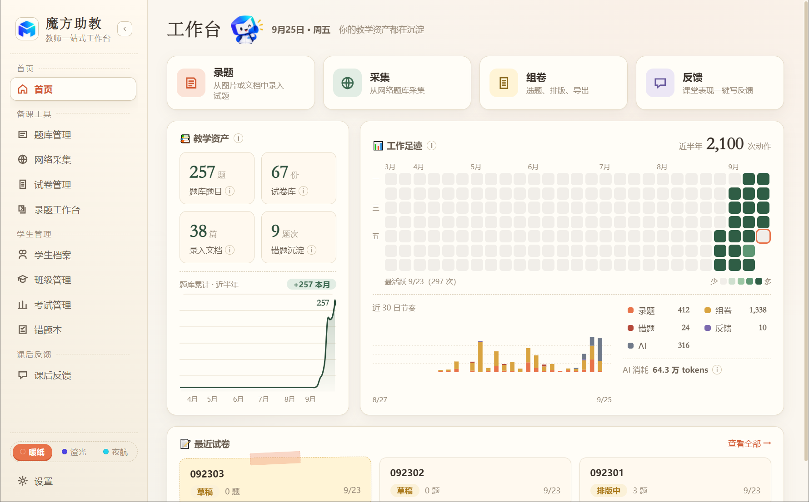
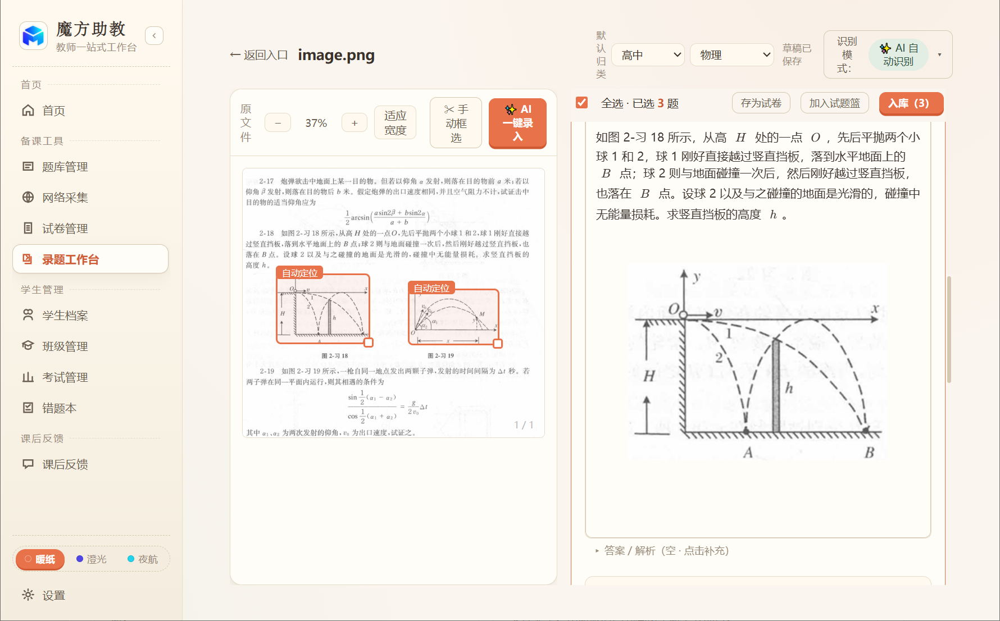
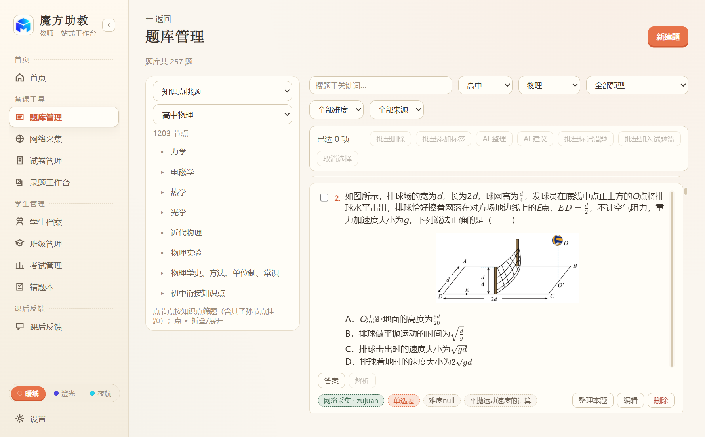
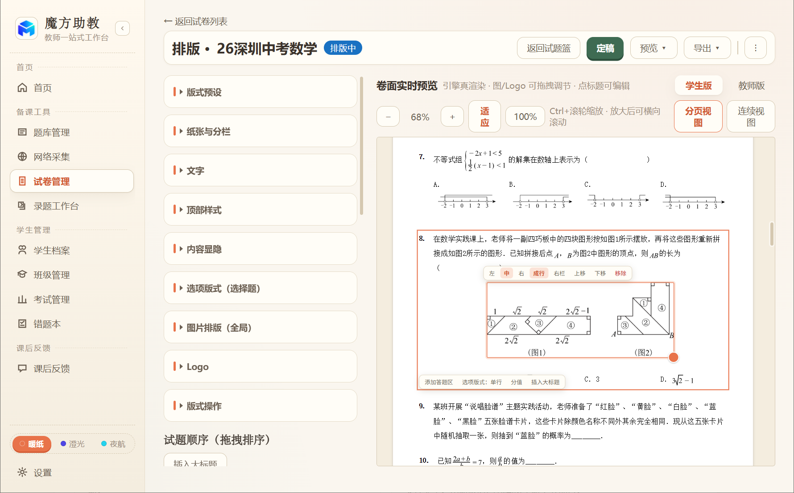
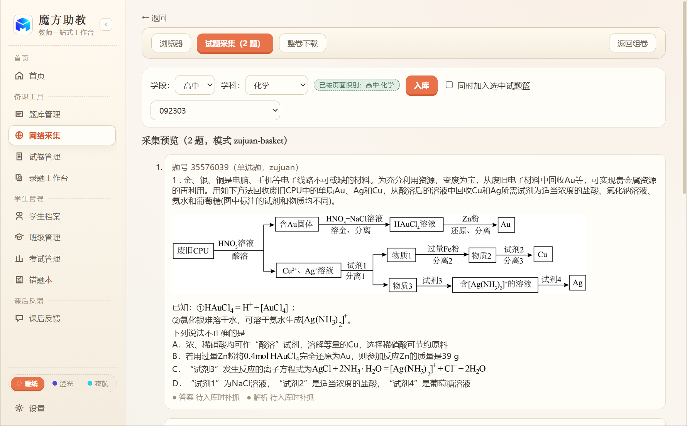

# 魔方助教（Mofang Assistant）

教师的一站式桌面工作台：把题目从照片、截图、PDF 或网页搬进题库，AI 辅助识别与整理，自由组卷排版导出，兼顾错题本与课后反馈。Windows 桌面单机应用，数据全部保存在本机。

> 本仓库为**源码**发布。普通使用建议直接下载官方发行版（见下「下载」），无需自行构建。

## 界面速览

| | |
|---|---|
|  |  |
|  |  |
|  | |

## 下载

官方发行版（Windows 安装包 / 便携版，含使用指南）：

**https://mofang-assistant.larqitek.com/**

## 本地构建（三步）

依赖 Node.js 20+（在 Node 24 上开发）。国内网络建议先给 Electron 设镜像：

```bash
# 国内镜像（可选）
export ELECTRON_MIRROR=https://npmmirror.com/mirrors/electron/
```

```bash
npm install     # 1. 安装依赖
npm run build   # 2. 构建渲染层 + 主进程
npm start       # 3. 启动应用
```

跑测试：`npm test`（Windows 为目标平台，部分用例在非 Windows 上跳过）。打包：`npm run dist:win`。

说明：AI 录题/整理能力需要自备模型 API Key（应用内「设置 → 模型配置」填写，只存本机）；不配置 Key 时除 AI 能力外全部功能可用。

## 许可

本项目以 [CC BY-NC-SA 4.0](LICENSE)（知识共享 署名-非商业性使用-相同方式共享 4.0）发布。人话版：

- **可以用** —— 自由使用、复制、分发；
- **可以改** —— 修改、二次开发都行，但衍生作品必须**同样以 CC BY-NC-SA 4.0 开源**；
- **禁商用** —— 不得将本项目或衍生作品用于商业盈利目的。

## 反馈

遇到问题或有意见，欢迎提 **Issue**。目前**不接收 Pull Request**（敬请谅解）。

## 与官方发行版的差异

本仓库构建出的版本与官网下载的官方发行版相比：**不含官方更新与公告通道**——分发基址置空后应用自动降级，更新检查恒「已是最新」（需自行更新请重新下载），公告栏回落内置文案，其余功能完全一致。
